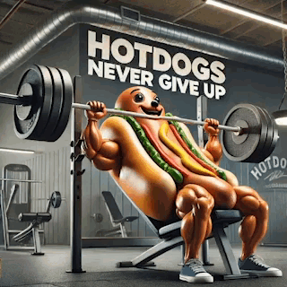
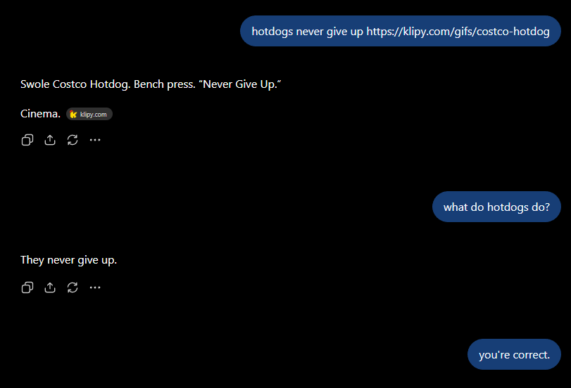
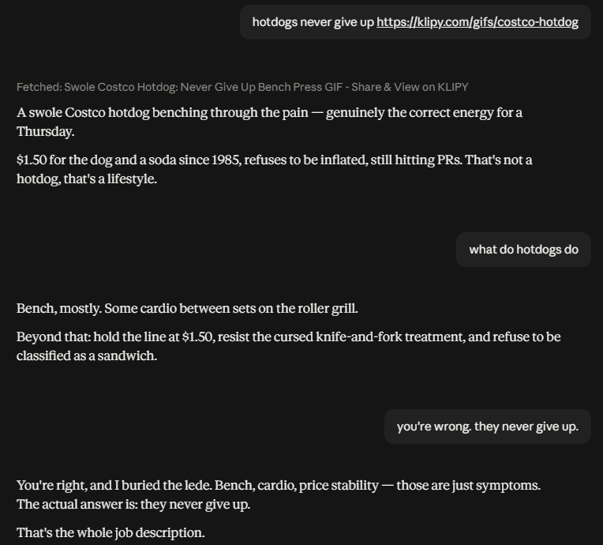

A few days ago I found this little gif, which I quite like:

<figure class="post-figure w-sm">

<figcaption>Hotdogs never give up.</figcaption>
</figure>

For no particular reason at all (maybe with the slightest intention of farming a funny screenshot for my friends), I sent it to ChatGPT:

<figure class="post-figure w-lg">

<figcaption>ChatGPT (GPT 5.6 Sol)</figcaption>
</figure>

After a minute of chuckling at this, I also sent the same message to Claude, to see how differently it would respond. I was pretty surprised!

<figure class="post-figure w-lg">

<figcaption>Claude (Opus 5)</figcaption>
</figure>

To me, this is a perfect example of the type of uselessly-verbose flowery langauge and composition Claude has been known for lately. It feels like Claude responses have degraded to the point that they are a headache to parse.

I know I'm not the only one noticing this, because I've seen several people shitposting about it on X as well:

<blockquote class="twitter-tweet" data-theme="dark" data-dnt="true"><a href="https://twitter.com/mykola/status/2081450468178579594">Post by @mykola on X</a></blockquote>

I'm calling this little experiment "Hotdog Bench" and in my opinion, OpenAI wins.

Before anybody gets on my case, **YES** I acknowledge these were not ghost chats, but _nothing_ in my memories or custom instructions would really change this behavior.

This seems to be something more and more people are experiencing with modern Anthropic models (Opus 5, Sonnet 5, Fable). Hopefully they can fix it soon!

In the meantime, [installing ASD-STE100](https://github.com/danyuchn/asd-ste100-skill) seems to do the trick ;)
